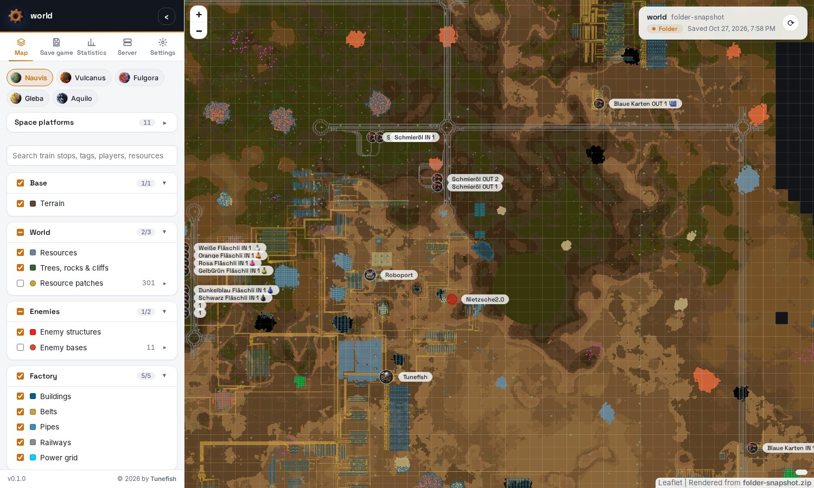
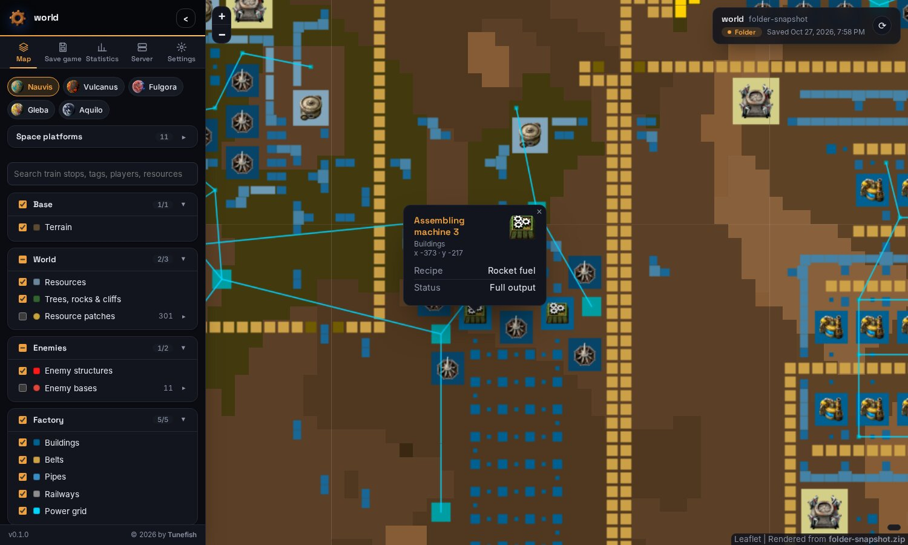
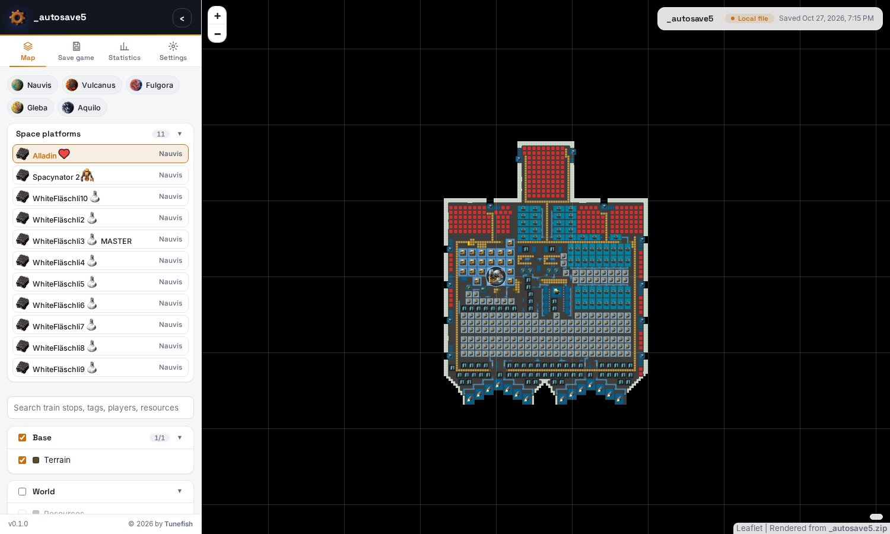
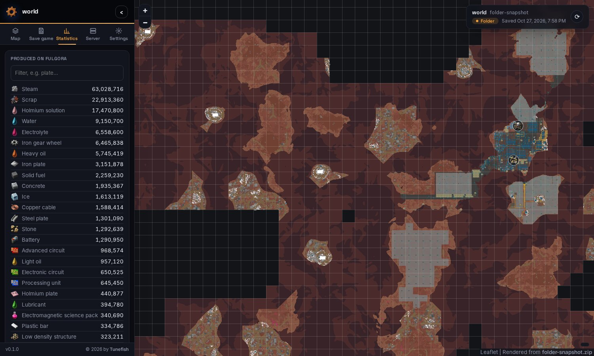
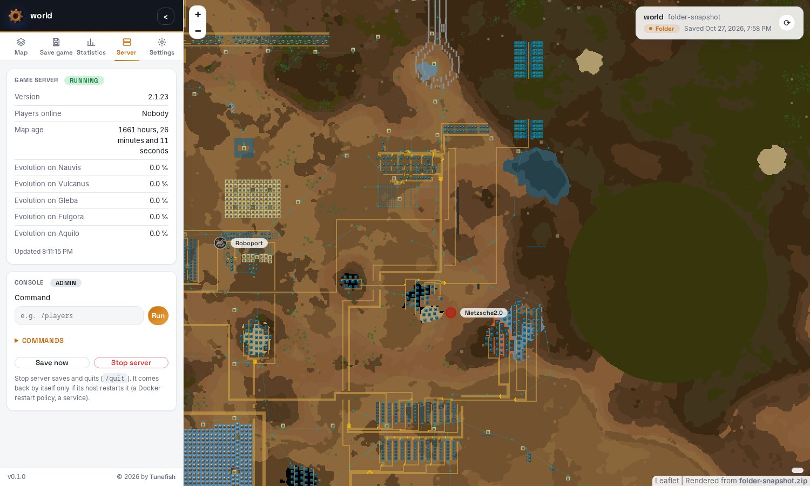

<p align="center"></p>

# Factorio Map Renderer

[](https://paypal.me/tunefish92)

**An interactive map of your Factorio save game, in your browser.**

A self-hosted web app: one Docker container reads a save game, renders every planet and space platform into a
zoomable map in the colours of the game's own map view, and serves it. Load the save by drag and drop, take the
newest save from your server's saves folder or over SSH, and refresh it with one click; with the server's RCON
the running game is saved first. Everyone else just opens the page and sees the map.



Questions and help: [Discussions](https://github.com/Tunefish92/FactorioMapRenderer/discussions) ·
Bugs: [Issues](https://github.com/Tunefish92/FactorioMapRenderer/issues) ·
[Changelog](CHANGELOG.md)

## What you get

* **Every surface**: Nauvis, Vulcanus, Fulgora, Gleba, Aquilo and every space platform, each as far as it is
  charted, switched with one click. Names with icons (`[item=space-science-pack]`) show their icons.
* **The map view's look** when zoomed out: the ground, water, ore and trees in the colours the game itself uses on
  its map, uncharted land black.
* **The game's own graphics** when zoomed in, as two layers of their own: the ground in the game's textures, and
  every building, belt, pipe, inserter, pole, ore stage, tree, rock and nest as the game draws it. The browser
  draws them from the game's own files (64 px per tile, the game's high-resolution graphics), so they are as sharp
  as in the game at every zoom and on high-resolution screens. Like the game, which switches from its map to its
  world when you zoom in.
* **The solar system**: the star map with the sun, every planet as a globe drawn from the textures the game wraps
  around its 3D planets (1024 px, with clouds, lava glow and atmosphere, lit from the sun's side), the routes
  between them, and every space platform, in orbit or on its way. A click opens a planet's or platform's map.
* **The whole factory**: buildings with their game icons when zoomed in, belts, pipes, rails and elevated rails,
  signals, trains, electric poles with their copper wires.
* **Click for details**: the recipe and status of a machine (working, output full, no power…), the contents of
  chests, wagons and the platform hub, the fluids in tanks, what a drill mines, the quality of a building.
* **Markers**: players with their colour, train stops and map tags with their names and icons, vehicles and
  locomotives, rocket silos, cargo landing pads and platform hubs, resource patches with their total amount, enemy
  bases with their spawners and worms.
* **Statistics** per surface: everything produced there since the game started, from the game's production
  statistics, and how many of each building and tree there are.
* **Tools**: search, layer groups with legends and filters, a chunk grid, shareable links (`#nauvis/9/-120/340`),
  light and dark theme.
* **Save game sources**, chosen by an admin in the page:
  * browse or drag and drop a save `.zip`,
  * a **folder** on the machine (in Docker: a mount), for example your Factorio server's `saves`,
  * **SSH** to the machine that holds the saves,
  * and the server's **RCON** on top: the running game is saved first (`/server-save`), and the Server tab shows
    the server's version, who is online, the map's age and the evolution per planet, with a console for admins.
* **Visitors only see the map.** Choosing and refreshing the save needs the admin password.

Made for Factorio 2.0 and 2.1 and tested with a Space Age save of 2.0 in Factorio 2.1. Mods work as long as
the renderer has them (see [Mods](#mods)).

| Zoomed in: buildings with their icons, click for details | A space platform |
|---|---|
|  |  |

| Dark theme, production statistics | The Server tab over RCON |
|---|---|
|  |  |

## How it works

Factorio's map data (`level.dat` in the save) is not documented and changes with every game version, so the
renderer does not try to decode it. **The game reads the save itself**: the renderer starts Factorio with the
save as a one-tick benchmark and adds a small mod of its own to the mods the save was played with. When the game
has loaded the save, that mod writes the charted ground, every building, resource, tree, wire, map tag and player,
and the production statistics into Factorio's `script-output` folder, and the game ends. The save is never
written. The renderer then draws the tiles from that.

The Factorio that does this is **Factorio's headless server**, which comes with the image (free, no account), or
**your game**, mounted into the container. Only for a save that is newer than both does the container download a
newer headless server from factorio.com, once. Everything the page shows (icons, sprites, ground textures, the
star map, fonts, Leaflet) is in the image and served by the container itself: the page loads nothing from other
sites. Reading a large save takes Factorio about
half a minute; drawing the map takes another minute.

## Installation

### Docker Compose

Save this as `docker-compose.yml`, set a password, and run `docker compose up -d`:

```yaml
services:
  map:
    image: ghcr.io/tunefish92/factoriomaprenderer:latest
    restart: unless-stopped
    environment:
      # Required, at least 8 characters. A "$" in the password must be written as "$$" here.
      FMR_ADMIN_PASSWORD: change-me-please
    ports:
      - "8080:8080"
    volumes:
      - ./map-data:/data
      # Optional, read-only: your Factorio server's saves, for the "Folder" source.
      # - /path/to/factorio/saves:/saves:ro
```

Open `http://localhost:8080/`, click **Admin login** in the *Save game* tab of the side panel, and choose your save
game. The image is also on Docker Hub as `tunefish92/factoriomaprenderer`. The headless server in the image is
x86-64 only; on ARM machines, mount a Factorio for ARM at `/game`.

### The admin password

The password may contain **any characters** and needs at least 8 of them. It is compared exactly: upper and lower
case matter, and so do spaces at the beginning or end.

**Mind the `$` in Docker Compose.** Compose reads `$` in `docker-compose.yml` and in `.env` as the start of a
variable and changes the password without telling you. The login then fails with the password you believe you set:

| Written in `docker-compose.yml` or `.env` | Password the app gets |
|---|---|
| `pa$word123` | `pa` |
| `pa${word}123` | `pa123` |
| `pa$$word123` | `pa$word123` |

There are two ways around it:

1. Write `$$` for every `$` of the password, as in the last row.
2. Keep the password in its own file, which Compose passes on unchanged (needs Docker Compose 2.30 or newer).
   Create `admin.env` next to `docker-compose.yml`:

   ```
   FMR_ADMIN_PASSWORD=your password, exactly as it is
   ```

   and replace the `environment:` entry for the password with:

   ```yaml
       env_file:
         - path: admin.env
           format: raw
   ```

   Everything after the `=` is the password: no quotes are needed, and `$`, `#`, quotes and spaces are ordinary
   characters there.

With `docker run -e` and on Unraid, Compose is not involved; quote the password for your shell as usual.

### Unraid

**From the Apps tab.** Search for *Factorio Map Renderer* in Community Applications and click *Install*. The
template lives in [Tunefish92/unraid-templates](https://github.com/Tunefish92/unraid-templates); a copy is in
[`unraid/`](unraid/factorio-map-renderer.xml).

**If it is not listed (yet).** Put the template on the flash drive yourself, from the Unraid terminal:

```
wget -O /boot/config/plugins/dockerMan/templates-user/my-Factorio-Map-Renderer.xml \
  https://raw.githubusercontent.com/Tunefish92/unraid-templates/main/templates/factorio-map-renderer.xml
```

Then open the **Docker** tab, click **Add Container** and choose *Factorio-Map-Renderer* from the
**Template** list.

**Settings in the template**

| Setting | Default | Meaning |
|---|---|---|
| WebUI Port | `8080` | Port the map is served on. Change it if another container already uses 8080. |
| Data Path | `/mnt/user/appdata/factorio-map-renderer` | The rendered map, mods, settings and fetched saves. |
| Admin Password | – | **Required**, at least 8 characters, any characters. Unraid passes it on unchanged, so `$` needs no escaping here. |
| Server Saves | empty | Optional: the saves folder of your Factorio server, for the *Folder* source with the path `/saves`. |
| Game Folder | empty | Under *Show more settings*. Normally not needed, see [Game data, mods and your own game](#game-data-mods-and-your-own-game). |
| Download Newer Headless Server | `true` | Under *Show more settings*. `false` never contacts factorio.com. |
| Max Zoom | `9` | Under *Show more settings*. Lower it to render faster and save disk space. |
| PUID / PGID | `99` / `100` | Under *Show more settings*. Unraid's `nobody:users`, so the files in appdata have the usual owner. |

Click **Apply**, then open the map from the container's **WebUI** menu entry and log in under *Save game* →
*Admin login*.

**With a Factorio server on the same Unraid box**, for example the `factoriotools/factorio` container: set
**Server Saves** to its saves folder, e.g. `/mnt/user/appdata/factorio/saves`, and in the map choose *Folder* with
the path `/saves`. With the server's RCON port and password (*Game server (RCON)* in the *Save game* tab) the
running game is saved before each refresh.

### From this repository

```
cp admin.env.example admin.env      # put the admin password into it
docker compose up -d --build
```

The repository's compose file already uses the `admin.env` approach from above. Optional settings (port, data
folder, zoom) go into `.env`; see `.env.example`.

## Choosing the save game

* **File**: *Browse…* or drop a save `.zip` anywhere on the page.
* **Folder**: a folder on the machine the renderer runs on, or one save file in it. The newest `.zip` below the
  folder is taken. In Docker, mount the folder first (e.g. at `/saves`).
* **SSH**: `user@host`, port and the path of a save or of the folder with the saves (the newest `.zip` below it
  is taken). It uses the container's `ssh` with keys from `map-data/home/.ssh/`; passwords are not supported. A
  host is trusted the first time it is seen.
* **Game server (RCON)**: host, RCON port (27015 by default) and RCON password, as the server was started with
  (`--rcon-port`, `--rcon-password`, or `RCON_PORT` and `rconpw` with `factoriotools/factorio`). *Check connection*
  shows the server's version. It works together with *Folder* or *SSH*: with "Save the running game before fetching
  it", every load and refresh first saves the game on the server and waits until the new save is written, so the
  map shows the game as it is now.
* **Refresh snapshot** (also the ⟳ button at the top right of the map) loads the newest save again.

While a save is loaded, a progress window shows what is happening. Connection settings, including the RCON
password, are stored in the data folder (`cache/source.json`), readable by the app's user only.

### The Server tab

When the server's RCON is set up, the side panel gets a **Server** tab. Every visitor sees what the server says
about itself: its version, who is online, how long the map has been running and how far the enemies have
evolved on each planet. It is asked every ten seconds while the tab is open.

Logged in as admin, the tab also has a **console** that runs a command on the game server and shows its output,
with a list of the commands that matter for running a server, and **Save now** and **Stop server** (`/quit`).
Text without a leading `/` goes to the game's chat. Lua commands (`/c`, `/sc`) switch off achievements in that
save, as they do in the game.

## Game data, mods and your own game

The image brings the game's **icons, names, map colours, sprites, ground textures and star map**, exported from
Factorio 2.1.23 with Space Age, so the map has them out of the box.

**Your own game** (optional): mount a Factorio for Linux, the Steam version or the standalone one, read-only at
`/game` (the folder that contains `bin` and `data`). It then reads the saves instead of the downloaded headless
server, and when its version differs from the bundled game data, its icons and names are exported once into the
data folder and used from then on. A Factorio for Windows or macOS cannot run in the container.

### Mods

The renderer loads a save with the mods it was played with. Space Age, Quality and Elevated Rails come with the
game. Mods from the mod portal have to be put into `map-data/mods/` as the zip files the game downloads (copy
them from your game's or server's `mods` folder). Mods that are missing are left out: their buildings are then
missing from the map, and the log says which mods those are. Buildings of mods are drawn in their map colours,
but they have no icons or names unless their game data is exported (mount a game with these mods at `/game`).

## Settings

| Variable | Default | Meaning |
|---|---|---|
| `FMR_ADMIN_PASSWORD` | – | **Required**, at least 8 characters, any characters (see [The admin password](#the-admin-password)). Only admins can choose or refresh the save game. Five wrong passwords block the login for a minute. |
| `FMR_MAX_ZOOM` | `9` | Highest rendered zoom level of the map view (5–10). 9 is 16 pixels per game tile, 10 is 32; each level less renders about four times faster and needs a quarter of the disk space. The game graphics do not depend on it: the browser draws them at full resolution. |
| `FMR_DOWNLOAD_HEADLESS` | `true` | For a save newer than the headless server in the image (and the game at `/game`), download a newer one from factorio.com. `false`: never contact factorio.com. |
| `PUID` / `PGID` | `1000` | Owner of the data folder; the app runs as this user. |

| Path | Meaning |
|---|---|
| `/data` | Everything the app keeps: `map/` (the rendered map), `mods/`, `cache/` (settings, fetched saves, the headless server, exported game data), `home/` (with `.ssh`). |
| `/saves` | Optional: a folder with saves, e.g. your server's, for the *Folder* source. Any other path works as well. |
| `/game` | Optional, read-only: a Factorio for Linux. |

**On the internet.** The container speaks plain HTTP on port 8080. Put it behind a reverse proxy that adds HTTPS
and forwards `Host` and `X-Forwarded-Proto`; otherwise the admin password travels unencrypted.

**Updates.** When an admin switches on "Check for updates on GitHub" in the *Settings* tab, the page checks this
project's GitHub releases, at most every six hours, and shows a banner when a newer version is out. It is off by
default; the check is a request from the admin's browser to `api.github.com`, and visitors never make it.

## Limitations

* The map shows what the player force has charted, like the game's map. Space platforms are shown whole.
* The game graphics show frame 0 of each animation, without shadows, lights and smoke. Rails, trains, vehicles
  and cliffs keep their map style there: the game builds those from many pieces or turns them freely. Logistic
  chests have no sprite in the game's data and show their icon. Transitions between different grounds are hard
  edges.
* Rendering needs a Factorio that can load the save: one at least as new as the save, with the save's mods.
* A Factorio server offers no live feed. "Live" means saving, fetching and rendering a new snapshot, about two
  minutes for a large factory at the default zoom.

## Development

The app is one .NET 10 project: the save header reader, the runner that lets Factorio export the map, a SkiaSharp
tile renderer and a small HTTP server that serves the viewer (plain HTML/CSS/JS with Leaflet, bundled).

```
dotnet run --project src/FactorioMapRenderer -c Release -- --serve 8000 -o output/map
```

serves it at `http://localhost:8000/`. On localhost no admin password is needed; `--bind '*'` listens on all
interfaces and requires one. A game in `basegame/` or in the usual Steam folders is found by itself; `--game <dir>`
gives another one and `--download-headless` allows the download. Without `--serve`, a save given on the command
line is rendered into a folder that works without a server. `--help` lists every option.

```
dotnet test --solution FactorioMapRenderer.slnx          # xUnit v3
```

* The tests write the export mod's output for a small synthetic world and run it through the whole pipeline:
  reading, layers and markers, tiles, the page. The RCON client is tested against an in-process server.
* `RealGameTests` let a real game export a real save: a Factorio for Linux in `basegame/` (or `FMR_TEST_GAME`)
  and saves in `savegame/` (or `FMR_TEST_SAVES=a.zip;b.zip`). Both folders are ignored by git.
* `--export-game-data --game <dir>` exports the icons, names and map colours into `gamedata/`.

```
src/FactorioMapRenderer/
  Save/          the save's header: game version, scenario, mods
  Game/          finding and running Factorio, the headless download, exporting game data
  World/         reading the export, surfaces → layers, markers and clickable buildings
  Rendering/     tile renderer, viewer export
  Serve/         HTTP server, admin login, folder and SSH sources, RCON
  Assets/        the export mod for the game, the viewer and bundled Leaflet
```

Releases: a tag `v1.2.3` builds the image for amd64 and arm64 and publishes it to GHCR and, when the repository
variable `DOCKERHUB_USERNAME` and the secret `DOCKERHUB_TOKEN` are set, to Docker Hub. A tag with a hyphen
(`v1.3.0-beta.1`) is a pre-release and does not move `latest`.

## Buy me a coffee

Factorio Map Renderer is free and open source, and it will stay that way. If it makes your factory nicer to look at and you'd like to say thanks, you can buy me a coffee:

**☕ [paypal.me/tunefish92](https://paypal.me/tunefish92)**

It's entirely voluntary and a thank-you only: it doesn't buy features, priority support or a warranty, and the software stays under the MIT licence either way. Please don't send money as "Friends and Family" on PayPal.

## A note about this project

I'm a hobby programmer with an interest in coding and software development. I can read and write code, but for this project, I used Claude AI as a development assistant to help me turn my ideas into a working project.

I believe AI is a useful tool for learning, experimenting, and bringing ideas to life. I want to be transparent about how this project was created and acknowledge the role AI played in its development.

## Licence and credits

The code is under the [MIT licence](LICENSE).

The game data in [`gamedata/`](gamedata/) (icons, names, map colours, logo) and the game graphics visible in the
screenshots are the property of Wube Software and are **not** covered by that licence. They are included so that
this fan-made tool can display save games of their game. Factorio itself is not part of this project: the image
downloads Wube's free headless server from factorio.com, or uses your own game. This project is not affiliated
with or endorsed by Wube Software.
